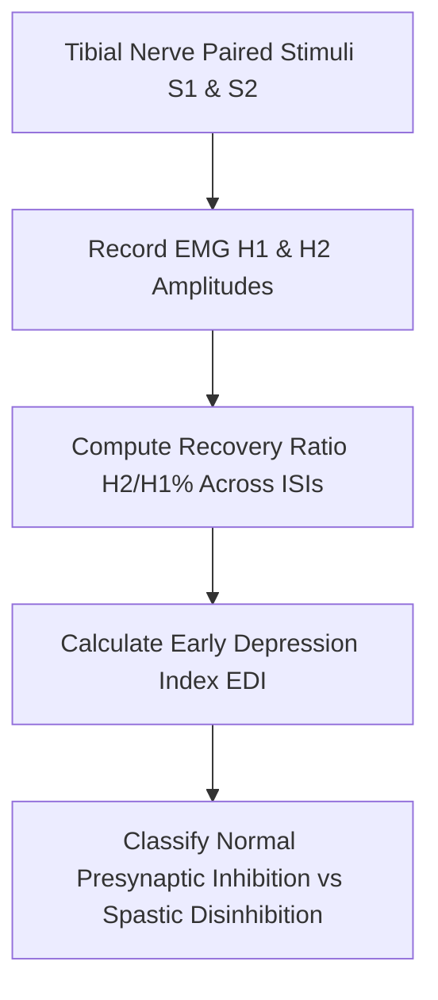

# Somatosensory H-Reflex Recovery Curve Personal Agent Skill

[](LICENSE)
[](https://www.python.org/)
[]()
[]()
[]()

Deterministic, zero-mock personal agent micro-skill for calculating Hoffmann Reflex (H-reflex) paired-pulse recovery ratios ($H_2/H_1\%$), Early Depression Index (EDI), and Central Spinal Disinhibition Index across inter-stimulus intervals.

## Architecture



## Quickstart

```python
from client import HReflexRecoveryCurveClient

client = HReflexRecoveryCurveClient()
result = client.evaluate_recovery_curve(
    h1_baseline_amplitude_mv=3.5,
    isi_responses=[
        {"isi_ms": 50.0, "h2_amplitude_mv": 0.20},
        {"isi_ms": 100.0, "h2_amplitude_mv": 0.50},
        {"isi_ms": 200.0, "h2_amplitude_mv": 1.40},
        {"isi_ms": 500.0, "h2_amplitude_mv": 3.10}
    ]
)
print(result)
```

## License

Apache-2.0
